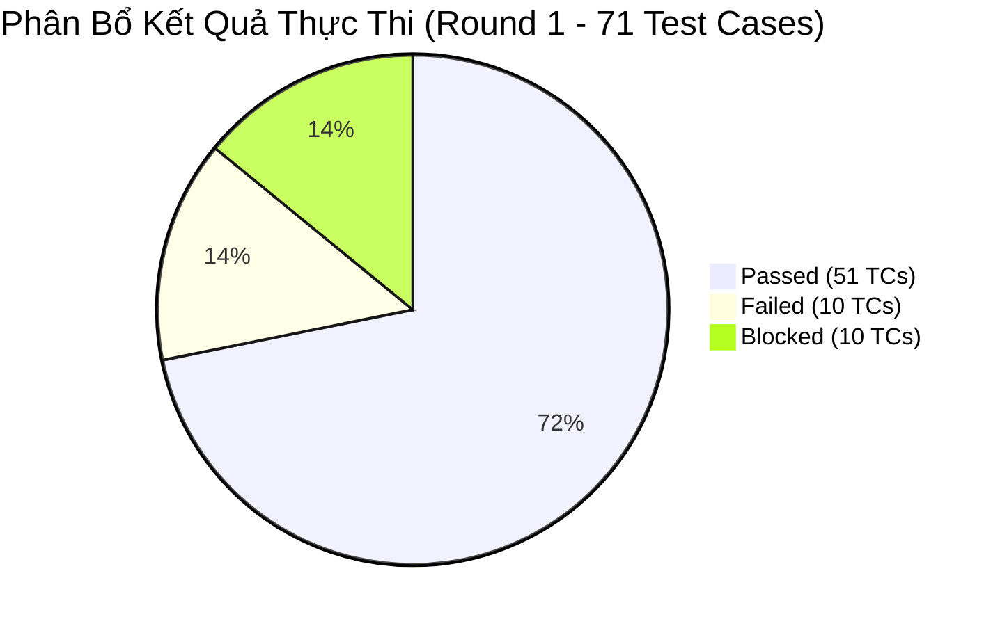
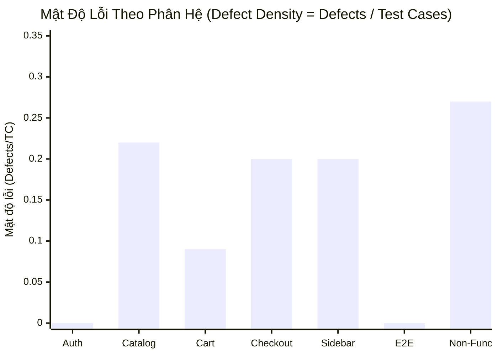
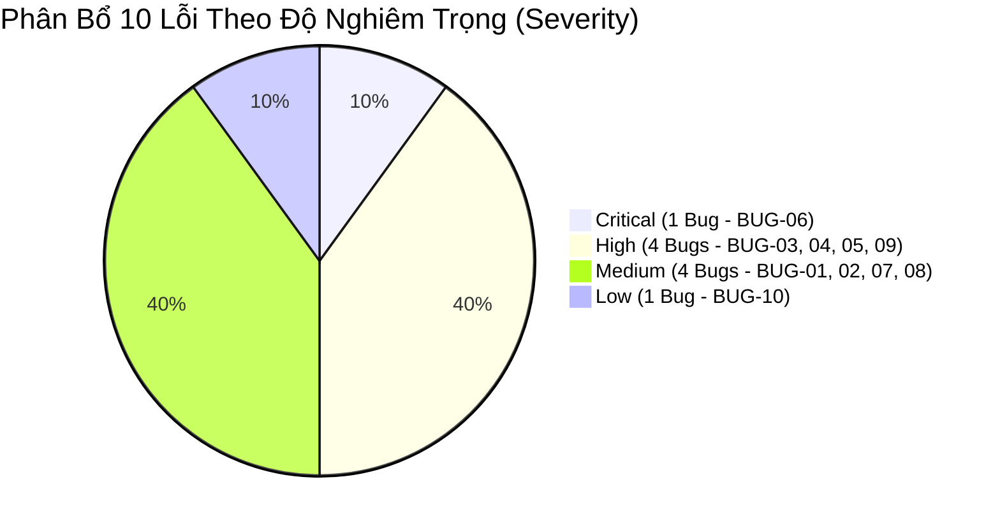

# Quality Dashboard: SauceDemo E-Commerce Web Application

Document ID: QD-SAUCEDEMO-01  
Target Application: SauceDemo (https://www.saucedemo.com/)  
Author: QA - Khổng Đức Anh  
Execution Cycle: Test Cycle 1 (Round 1)  
Date: 30/09/2026  

---

## Mục Lục

- [1. Executive QA Scorecard](#1-executive-qa-scorecard)
- [2. Execution Status Visualization](#2-execution-status-visualization)
- [3. Defect Density by Feature Area](#3-defect-density-by-feature-area)
- [4. Defect Severity & Priority Distribution](#4-defect-severity--priority-distribution)

---

## 1. Executive QA Scorecard

Bảng chỉ số kiểm thử định lượng tổng hợp đánh giá chất lượng toàn diện của sản phẩm sau Vòng kiểm thử 1:

| **Metric** | **Actual** | **Target** | **Status** |
|:---|:---:|:---:|:---:|
| Total Planned Tests | 71 TCs | - | Completed (100%) |
| Executed Tests | 61 TCs | > 90.0% | 85.9% (10 Blocked) |
| Passed Tests | 51 TCs | - | 83.6% of Executed |
| Failed Tests | 10 TCs | - | 16.4% of Executed |
| Blocked Tests | 10 TCs | - | 14.1% of Planned (No Backend/DB) |
| Pass Rate (Executed Tests) | 83.6% | > 90.0% | Below Target |
| Pass Rate (All Planned Tests) | 71.8% | > 90.0% | Below Target (Includes Blocked) |
| Requirement Coverage | 100.0% | 100.0% | Target Met |
| Defect Density | 0.14 | < 0.20 | Target Met |
| Open Critical Defects | 1 Bug (BUG-06) | 0 | Blocker for Production |

---

## 2. Execution Status Visualization

Biểu đồ tròn thể hiện tỷ lệ phân bổ kết quả thực thi trên toàn bộ 71 ca kiểm thử:

### Tóm Tắt Tỷ Lệ Thực Thi

- **Passed:** 51 ca kiểm thử (83.6% trên số ca thực thi, 71.8% trên tổng kế hoạch).
- **Failed:** 10 ca kiểm thử (16.4% trên số ca thực thi, 14.1% trên tổng kế hoạch) — phát hiện 10 khiếm khuyết thực tế trong hệ thống.
- **Blocked:** 10 ca kiểm thử (14.1% trên tổng kế hoạch) — các ca thuộc phân hệ API và SQL CSDL do không có môi trường backend khả dụng.

---

## 3. Defect Density by Feature Area

Mật độ lỗi kỹ thuật được tính theo công thức: Defect Density = Số Bugs / Tổng Test Cases của từng phân hệ. Chỉ số này giúp xác định những vùng tập trung rủi ro cao trong hệ thống:

### Bảng Thống Kê & Đối Soát Chi Tiết Từng Phân Hệ

Dưới đây là bảng số liệu phân rã chi tiết giữa quy mô kiểm thử, số lượng lỗi phát hiện và mức độ rủi ro tương ứng:

| **Component / Module** | **Planned** | **Passed** | **Failed** | **Blocked** | **Executed Pass Rate** | **Defects** | **Defect Density** | **Risk Level** |
|:---|:---:|:---:|:---:|:---:|:---:|:---:|:---:|:---:|
| Authentication & Login | 9 | 9 | 0 | 0 | 100.0% | 0 | 0.00 | Low |
| Product Catalog & Details | 9 | 7 | 2 | 0 | 77.8% | 2 | 0.22 | Medium |
| Shopping Cart Management | 11 | 9 | 2 | 0 | 81.8% | 2 | 0.18 | Medium |
| Checkout & Order Placement | 15 | 13 | 2 | 0 | 86.7% | 2 | 0.13 | High |
| Sidebar Navigation & State | 5 | 4 | 1 | 0 | 80.0% | 1 | 0.20 | Medium |
| End-to-End Core Journey | 1 | 1 | 0 | 0 | 100.0% | 0 | 0.00 | Low |
| Non-Functional Quality | 11 | 8 | 3 | 0 | 72.7% | 3 | 0.27 | High |
| Backend API Testing | 5 | 0 | 0 | 5 | N/A | 0 | 0.00 | Blocked |
| Database SQL Testing | 5 | 0 | 0 | 5 | N/A | 0 | 0.00 | Blocked |
| Total / Overall | 71 | 51 | 10 | 10 | 83.6% | 10 | 0.14 | Critical |

---

## 4. Defect Severity & Priority Distribution

Phân tích cơ cấu phân bổ của 10 lỗi phát hiện theo mức độ nghiêm trọng kỹ thuật (Severity) và ma trận đối chiếu với độ ưu tiên kinh doanh (Priority):

### Ma Trận Severity vs Priority (2x2)

Ma trận đối chiếu giữa mức độ nghiêm trọng kỹ thuật (Severity - do QA đánh giá) và mức độ ưu tiên khắc phục (Priority - do PO/QA thống nhất):

| **Severity \ Priority** | **High Priority (Khắc Phục Ngay)** | **Medium Priority (Kế Hoạch Sprint)** | **Low Priority (Backlog)** |
|:---|:---|:---|:---|
| Critical | BUG-06 (Finish runtime exception) | - | - |
| High | BUG-03, BUG-04, BUG-05, BUG-09 | - | - |
| Medium | BUG-01 | BUG-02, BUG-07, BUG-08 | - |
| Low | - | - | BUG-10 |

---

Xem báo cáo tổng kết kiểm thử chính thức tại [Test Summary Report](../09_Test_Summary_Report/09_Test_Summary_Report.md).
