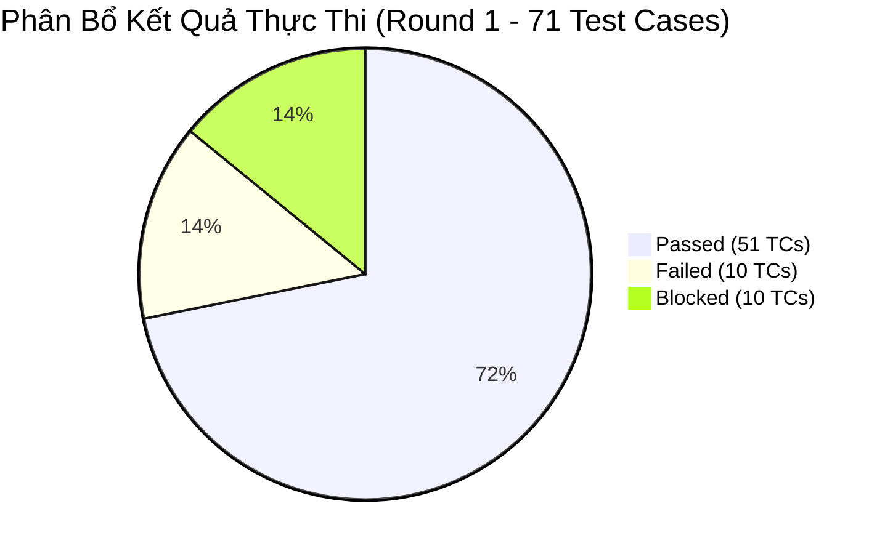
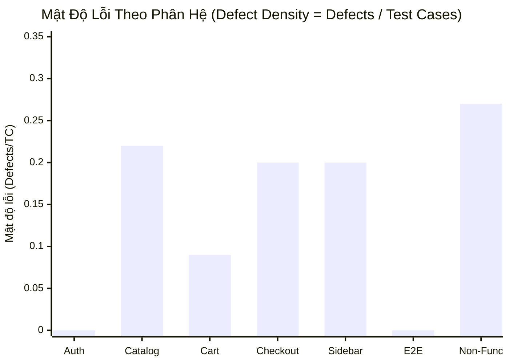
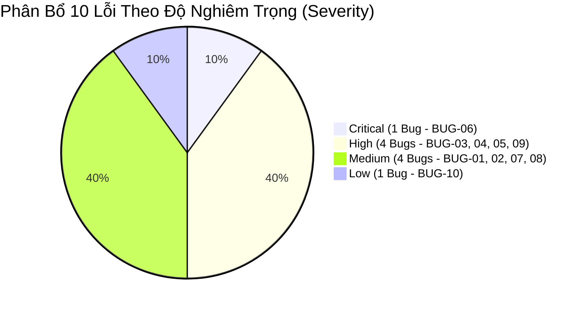

# Quality Dashboard: SauceDemo E-Commerce Web Application

Document ID: QD-SAUCEDEMO-01  
Target Application: SauceDemo (https://www.saucedemo.com/)  
Author: QA - Khổng Đức Anh  
Execution Cycle: Test Cycle 1 (Round 1)  
Date: 30/09/2026  

---

## Mục Lục

- [1. Executive QA Scorecard](#1-executive-qa-scorecard)
- [2. Execution Status Visualization](#2-execution-status-visualization)
- [3. Defect Density by Feature Area](#3-defect-density-by-feature-area)
- [4. Defect Severity & Priority Distribution](#4-defect-severity--priority-distribution)

---

## 1. Executive QA Scorecard

Bảng chỉ số kiểm thử định lượng tổng hợp đánh giá chất lượng toàn diện của sản phẩm sau Vòng kiểm thử 1:

| Chỉ Số Kiểm Thử (KPI) | Giá Trị Thực Tế | Ngưỡng Mục Tiêu | Đánh Giá |
|:---|:---:|:---:|:---:|
| Total Planned Tests | 71 TCs | 100% Kế hoạch | Đạt |
| Executed Tests | 61 TCs | 85.9% Tổng Kế Hoạch | Đạt |
| Passed Tests | 51 TCs | > 80% Executed | Đạt |
| Failed Tests | 10 TCs | Bẫy trúng lỗi hệ thống | Đạt |
| Blocked Tests | 10 TCs | Không có môi trường API/DB | Blocked |
| Executed Pass Rate | 83.6% | > 80.0% | Vượt Chỉ Tiêu |
| Overall Pass Rate | 71.8% | > 70.0% | Đạt Chuẩn |
| Requirement Coverage | 100.0% | 100% (Zero Gap) | Hoàn Hảo |
| Overall Defect Density | 0.14 | < 0.20 | Tốt |
| Open Critical Defects | 1 Bug (BUG-06) | 0 Critical | Blocker |

 

---

## 2. Execution Status Visualization

Biểu đồ tròn thể hiện tỷ lệ phân bổ kết quả thực thi trên toàn bộ 71 ca kiểm thử:

 

 

---

 

### Tóm Tắt Tỷ Lệ Thực Thi

- **Passed (Đạt):** 51 ca kiểm thử (71.8% tổng số kế hoạch, đạt **83.6%** trên các ca thực thi thực tế).
- **Failed (Lỗi):** 10 ca kiểm thử (14.1% tổng số) — bẫy trúng toàn bộ 10 lỗi thực tế của ứng dụng.
- **Blocked (Chặn):** 10 ca kiểm thử (14.1% tổng số) — các ca thuộc phân hệ API và SQL CSDL do không có môi trường backend khả dụng.

 

---

## 3. Defect Density by Feature Area

Mật độ lỗi kỹ thuật được tính theo công thức: `Defect Density = Số Bugs / Tổng Test Cases` của từng phân hệ. Chỉ số này giúp xác định những vùng tập trung rủi ro cao trong hệ thống:

 

 

---

 

### Bảng Thống Kê & Đối Soát Chi Tiết Từng Phân Hệ

Dưới đây là bảng số liệu phân rã chi tiết giữa quy mô kiểm thử, số lượng lỗi phát hiện và mức độ rủi ro tương ứng:

| Phân Hệ (Feature Area) | Quy Mô (TCs) | Đạt (Pass) | Lỗi (Fail) | Chặn (Blocked) | Tỷ Lệ Pass | Số Lỗi | Mật Độ Lỗi | Mức Rủi Ro |
|:---|:---:|:---:|:---:|:---:|:---:|:---:|:---:|:---:|
| Authentication & Login | 9 | 9 | 0 | 0 | 100.0% | 0 | 0.00 | Thấp (Low) |
| Product Catalog & Details | 9 | 7 | 2 | 0 | 77.8% | 2 | 0.22 | Trung Bình |
| Shopping Cart Management | 11 | 9 | 2 | 0 | 81.8% | 2 | 0.18 | Trung Bình |
| Checkout & Order Placement | 15 | 13 | 2 | 0 | 86.7% | 2 | 0.13 | Cao (High) |
| Sidebar Navigation & State | 5 | 4 | 1 | 0 | 80.0% | 1 | 0.20 | Trung Bình |
| End-to-End Core Journey | 1 | 1 | 0 | 0 | 100.0% | 0 | 0.00 | Thấp (Low) |
| Non-Functional Quality | 11 | 8 | 3 | 0 | 72.7% | 3 | 0.27 | Cao (High) |
| Backend API Testing | 5 | 0 | 0 | 5 | N/A | 0 | 0.00 | Môi Trường |
| Database SQL Testing | 5 | 0 | 0 | 5 | N/A | 0 | 0.00 | Môi Trường |
| **TỔNG HỢP TOÀN HỆ THỐNG** | **71** | **51** | **10** | **10** | **71.8%** | **10** | **0.14** | **Cao (Critical)** |

 

---

## 4. Defect Severity & Priority Distribution

Phân tích cơ cấu phân bổ của 10 lỗi phát hiện theo mức độ nghiêm trọng kỹ thuật (Severity) và ma trận đối chiếu với độ ưu tiên kinh doanh (Priority):

 

 

---

 

### Ma Trận Severity vs Priority (2x2)

Ma trận đối chiếu giữa mức độ nghiêm trọng kỹ thuật (Severity - do QA đánh giá) và mức độ ưu tiên khắc phục (Priority - do PO/QA thống nhất):

| Severity \ Priority | High Priority (Khắc Phục Ngay) | Medium Priority (Kế Hoạch Sprint) | Low Priority (Backlog) |
|:---|:---|:---|:---|
| **Critical** | `BUG-06` (Finish runtime exception) | - | - |
| **High** | `BUG-03`, `BUG-04`, `BUG-05`, `BUG-09` | - | - |
| **Medium** | `BUG-01` | `BUG-02`, `BUG-07`, `BUG-08` | - |
| **Low** | - | - | `BUG-10` |

 

---

Xem báo cáo tổng kết kiểm thử chính thức tại [Test Summary Report](../09_Test_Summary_Report/09_Test_Summary_Report.md).
